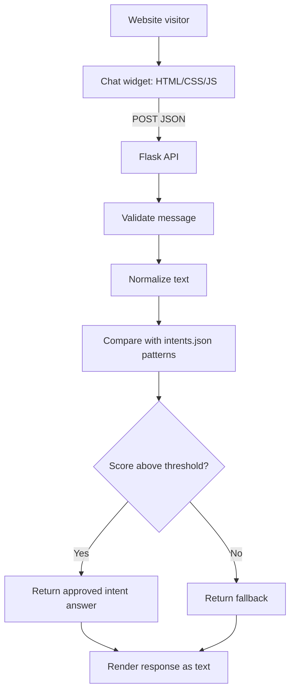

# Architecture

## Components
- Browser widget: sends messages to the API and uses `textContent` to display returned text.
- Flask API: serves the page and provides `/api/chat`, `/api/intents`, and `/health`.
- Chatbot engine: normalizes input and scores predefined patterns using token overlap and string similarity.
- `intents.json`: curated patterns and responses.
- Tests: cover matching and API input validation.

The current design is low-cost and explainable. Its scores are heuristics, not probabilities. Chat history is not stored server-side by default.
